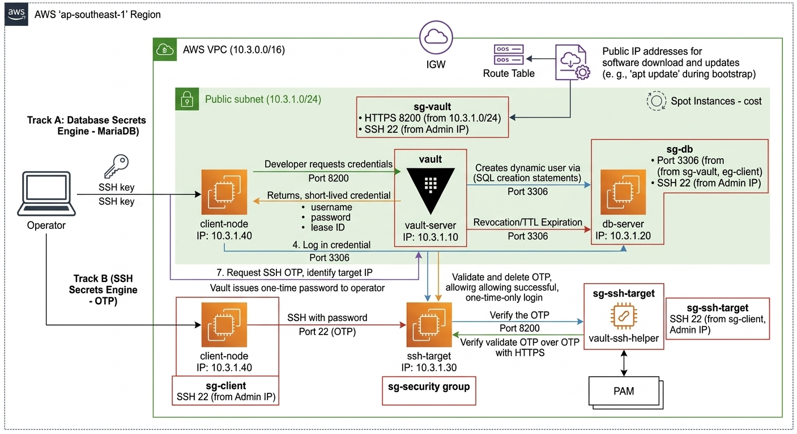

# vault-secret-lab

Praktikum **Secret Management (Sesi 26)** menggunakan **HashiCorp Vault** pada **AWS (ap-southeast-1)**.

Proyek ini mengimplementasikan **dua jalur sekaligus** dalam satu sistem yang dapat dibuat dan dihapus ulang (*reproducible*):

| Jalur | Secrets Engine | Tujuan |
|---|---|---|
| **A** | Database Secrets Engine (MariaDB) | Kredensial database dinamis berumur pendek (TTL), terhapus otomatis saat kedaluwarsa atau dicabut |
| **B** | SSH Secrets Engine (One-Time Password) | Login SSH dengan OTP sekali pakai yang divalidasi Vault lewat `vault-ssh-helper` dan PAM |

Panduan resmi yang dijadikan acuan:

- MySQL/MariaDB database secrets engine: https://developer.hashicorp.com/vault/docs/secrets/databases/mysql-maria
- One-Time SSH Passwords: https://developer.hashicorp.com/vault/docs/secrets/ssh/one-time-ssh-passwords

---

## Daftar Isi

1. [Gambaran Umum Lab](#1-gambaran-umum-lab)
2. [Arsitektur Infrastruktur](#2-arsitektur-infrastruktur)
3. [Spesifikasi Node dan Jaringan](#3-spesifikasi-node-dan-jaringan)
4. [Struktur Repositori](#4-struktur-repositori)
5. [Pembagian Otomatis dan Manual](#5-pembagian-otomatis-dan-manual)
6. [Prasyarat](#6-prasyarat)
7. [Langkah Setup dan Implementasi](#7-langkah-setup-dan-implementasi)
8. [Matriks Pengujian T-01 sampai T-14](#8-matriks-pengujian-t-01-sampai-t-14)
9. [Pembersihan Infrastruktur (Terraform Destroy)](#9-pembersihan-infrastruktur-terraform-destroy)
10. [Pemecahan Masalah](#10-pemecahan-masalah)
11. [Kesimpulan](#11-kesimpulan)
12. [Saran Pengembangan](#12-saran-pengembangan)
13. [Penutup](#13-penutup)

---

## 1. Gambaran Umum Lab

Lab ini menerapkan siklus hidup rahasia (*secret lifecycle*) secara aman:

- **Secret dan Confidentiality**: kredensial statis diganti kredensial dinamis berumur pendek. Komunikasi dilindungi TLS dengan sertifikat ber-SAN IP lokal.
- **Integrity dan Least Privilege (RBAC)**: hak akses dibatasi policy sempit per path, ditambah audit log menyeluruh.
- **Lifecycle Management**: pembuatan (*generate*), penggunaan, perpanjangan (*renew*), pencabutan (*revoke*), dan penghapusan otomatis berdasarkan TTL diuji seluruhnya.

Keputusan desain utama:

- Seluruh infrastruktur dibangun di **AWS Region ap-southeast-1** dengan **Spot Instance** untuk menekan biaya.
- Topologi **4 node** dengan peran terpisah. Pengujian tidak dilakukan dari laptop, tetapi dari **client-node** di dalam VPC yang sama (prinsip *Zero Trust*).
- Seluruh jaringan, Security Group, EC2, dan sertifikat TLS dibuat oleh **Terraform** sehingga lab dapat dihapus bersih dengan `terraform destroy`.
- Konfigurasi inti Vault (init, unseal, audit, policy, secrets engine, PAM) dikerjakan **manual** agar setiap tahap dapat dieksplorasi dan didokumentasikan.

---

## 2. Arsitektur Infrastruktur



Diagram menggambarkan dua alur utama dalam AWS VPC `10.3.0.0/16`. Seluruh komunikasi antar-instance memakai IP privat.

### 2.1 Alur Dasar

1. **Akses operator**: operator (laptop) masuk ke instance melalui internet memakai kunci SSH `vault-lab-key.pem`.
2. **Internet Gateway dan Route Table**: seluruh instance berada di public subnet `10.3.1.0/24` dan terhubung ke internet melalui IGW. Ini dibutuhkan saat *bootstrap* otomatis (misalnya `apt update` lewat User Data).

### 2.2 Alur Jalur A: Database Secrets Engine

1. **Permintaan kredensial**: dari client-node, pengguna meminta kredensial database ke vault-server (`10.3.1.10`) lewat HTTPS port 8200.
2. **Pembuatan user dinamis**: Vault terhubung ke MariaDB di db-server (`10.3.1.20:3306`) memakai akun `vaultadmin`, lalu menjalankan *creation statement* untuk membuat user unik ber-TTL.
3. **Penggunaan kredensial**: Vault mengembalikan `username`, `password`, dan `lease_id`. Client-node memakainya untuk login langsung ke db-server.
4. **Pencabutan otomatis**: saat TTL habis atau lease di-revoke, Vault terhubung kembali ke MariaDB dan menghapus user dinamis tersebut.

### 2.3 Alur Jalur B: SSH OTP

1. **Permintaan OTP**: dari client-node, pengguna meminta OTP ke vault-server untuk target tertentu.
2. **Pembuatan OTP**: Vault membuat OTP unik dan mengembalikannya ke pengguna.
3. **Akses SSH**: pengguna melakukan SSH (port 22) ke ssh-target (`10.3.1.30`) dan memasukkan OTP sebagai password.
4. **Verifikasi OTP**: modul PAM di ssh-target memanggil `vault-ssh-helper`, yang menghubungi vault-server (HTTPS 8200) untuk memvalidasi OTP.
5. **Login berhasil dan OTP dihapus**: jika valid, Vault langsung menghapus OTP sehingga tidak bisa dipakai kedua kali (*single-use*).

---

## 3. Spesifikasi Node dan Jaringan

### 3.1 Komponen Jaringan AWS

| Komponen | Nilai |
|---|---|
| Region | `ap-southeast-1` |
| VPC | `10.3.0.0/16` |
| Public Subnet | `10.3.1.0/24` |
| Internet Gateway dan Route Table | Jalur keluar internet untuk instalasi paket |
| OS seluruh node | Ubuntu 24.04 LTS |

### 3.2 Node EC2 (Spot Instance)

| No | Nama | IP Privat | Tipe | Peran dan Software |
|---|---|---|---|---|
| 1 | vault-server | `10.3.1.10` | t3.small | HashiCorp Vault, file storage lokal, TLS dengan SAN IP, audit log, **Elastic IP** |
| 2 | db-server | `10.3.1.20` | t3.micro | MariaDB, database `appdb`, akun admin `vaultadmin` |
| 3 | ssh-target | `10.3.1.30` | t3.micro | OpenSSH, PAM, `vault-ssh-helper` (v0.2.1), user `otpuser` |
| 4 | client-node | `10.3.1.40` | t3.micro | Vault CLI, MariaDB client, `sshpass`, `jq` |

### 3.3 Security Group

Tidak ada port yang dibuka ke publik (`0.0.0.0/0`) kecuali SSH admin yang dibatasi ke IP publik operator (`admin_cidr`).

| Security Group | Port Inbound | Sumber | Keterangan |
|---|---|---|---|
| `sg-vault` | TCP 8200 | Subnet VPC `10.3.1.0/24` | API Vault hanya dari dalam VPC |
| `sg-vault` | TCP 22 | IP publik admin | SSH admin |
| `sg-db` | TCP 3306 | `sg-vault` dan `sg-client` | MariaDB hanya untuk Vault dan client |
| `sg-db` | TCP 22 | IP publik admin | SSH admin |
| `sg-ssh-target` | TCP 22 | `sg-client` dan IP publik admin | SSH dari node pengujian dan admin |
| `sg-client` | TCP 22 | IP publik admin | Titik masuk operator |

---

## 4. Struktur Repositori

```
vault-secret-lab/
├── README.md
├── .gitignore
├── secret_manager.jpg          # Diagram arsitektur
├── terraform/
│   ├── versions.tf             # Versi Terraform dan provider (aws, tls, local)
│   ├── providers.tf            # AWS provider dan default tags
│   ├── variables.tf            # aws_region, admin_cidr, vpc_cidr, subnet_cidr
│   ├── network.tf              # VPC, IGW, subnet, route table
│   ├── security-groups.tf      # sg-client, sg-vault, sg-db, sg-ssh-target
│   ├── tls.tf                  # CA lab, sertifikat Vault, key pair SSH
│   ├── ec2.tf                  # 4 Spot Instance, Elastic IP, User Data
│   ├── outputs.tf              # IP publik dan perintah SSH
│   ├── terraform.tfvars.example
│   └── userdata/
│       ├── vault-server.sh
│       ├── db-server.sh
│       ├── ssh-target.sh
│       └── client-node.sh
├── vault/
│   ├── config/vault.hcl        # Konfigurasi server Vault (file storage + TLS)
│   ├── policies/
│   │   ├── admin.hcl
│   │   ├── db-readonly.hcl
│   │   ├── db-readwrite.hcl
│   │   └── ssh-otp.hcl
│   └── scripts/README.md
├── db/
│   ├── seed-appdb.sql          # Database contoh appdb
│   └── vault-admin-user.sql    # Akun vaultadmin dan app-static
├── ssh-target/
│   ├── helper-config.hcl       # Konfigurasi vault-ssh-helper
│   ├── pam-sshd.snippet        # Baris PAM untuk /etc/pam.d/sshd
│   └── sshd-config.snippet     # Parameter /etc/ssh/sshd_config
└── client/
    ├── demo-db.sh              # Demo opsional kredensial database
    └── demo-ssh.sh             # Demo opsional login SSH OTP
```

Fungsi tiap berkas Terraform:

| Berkas | Fungsi |
|---|---|
| `versions.tf` | Terraform minimal 1.5.0 dan provider `aws`, `tls`, `local` |
| `providers.tf` | AWS provider di `ap-southeast-1` dan *default tags* (`Project`, `Session`) |
| `variables.tf` | Variabel global lab |
| `network.tf` | VPC, Internet Gateway, public subnet, route table, dan asosiasinya |
| `security-groups.tf` | Empat Security Group dengan prinsip *least privilege* |
| `tls.tf` | CA lab, sertifikat server Vault (SAN `10.3.1.10` dan `127.0.0.1`), key pair SSH, dan berkas `vault-lab-key.pem` (izin 0400) |
| `ec2.tf` | AMI Ubuntu 24.04 terbaru, 4 Spot Instance dengan IP privat tetap, Elastic IP vault-server, dan User Data |
| `outputs.tf` | IP publik tiap instance dan perintah SSH |

Fungsi tiap skrip User Data:

| Skrip | Yang dikerjakan |
|---|---|
| `vault-server.sh` | Memasang Vault, menaruh sertifikat TLS dan CA, menulis `vault.hcl`, menaruh draf policy di `/opt/lab/vault/policies`, mengaktifkan service `vault` |
| `db-server.sh` | Memasang MariaDB, mengatur `bind-address = 0.0.0.0` dan `skip-name-resolve`, menjalankan SQL `appdb` dan `vaultadmin` |
| `ssh-target.sh` | Memasang `vault-ssh-helper` v0.2.1, membuat user `otpuser`, menaruh CA dan berkas snippet di `/opt/lab/ssh-target` |
| `client-node.sh` | Memasang Vault CLI, `mariadb-client`, `sshpass`, `jq`, mendaftarkan CA lab, dan mengatur `VAULT_ADDR` |

---

## 5. Pembagian Otomatis dan Manual

| Bagian | Cara | Keterangan |
|---|---|---|
| VPC, Security Group, 4 EC2 Spot, Elastic IP | Otomatis (Terraform) | Pendukung |
| Sertifikat TLS (CA dan SAN IP 10.3.1.10) | Otomatis (Terraform) | Dipercaya semua node |
| Instal Vault, MariaDB, vault-ssh-helper, client tools | Otomatis (User Data) | Setup biasa |
| Database `appdb` dan akun `vaultadmin` | Otomatis (User Data) | Berkas SQL di `db/` |
| Init, unseal, audit, policy, userpass | **Manual** | Inti tugas |
| Database Secrets Engine (MariaDB) | **Manual** | Mengikuti panduan Vault MySQL/MariaDB |
| SSH Secrets Engine (OTP), PAM, sshd | **Manual** | Mengikuti panduan Vault One-Time SSH Passwords |

Perintah Vault memakai alamat `https://10.3.1.10:8200`. Alamat ini sudah diatur otomatis lewat User Data, sehingga tidak perlu diketik ulang.

---

## 6. Prasyarat

### 6.1 Alat di Laptop Operator

| Kebutuhan | Cek dengan |
|---|---|
| Akun AWS dan AWS CLI yang sudah login | `aws sts get-caller-identity` |
| Terraform 1.5.0 atau lebih baru | `terraform version` |
| Klien SSH | `ssh -V` |
| IP publik operator | Buka https://checkip.amazonaws.com |

### 6.2 Izin IAM

Akun atau IAM User AWS harus memiliki akses berikut agar Terraform dapat membuat seluruh sumber daya:

- **AmazonVPCFullAccess**: membuat VPC, subnet, Internet Gateway, dan route table.
- **AmazonEC2FullAccess**: meluncurkan EC2 Spot Instance, membuat key pair, Elastic IP, dan Security Group.
- **IAMReadOnly** atau IAM kustom: validasi identitas lewat `aws sts get-caller-identity`.

### 6.3 Konfigurasi AWS CLI

```
aws configure
```

Isi AWS Access Key ID, Secret Access Key, Region `ap-southeast-1`, dan format output `json`. Verifikasi identitas:

```
aws sts get-caller-identity
```

> Tips: buka **4 jendela terminal** dan beri judul `vault-server`, `db-server`, `ssh-target`, `client-node`. Setiap langkah di bawah diberi label node tempat perintah dijalankan.

---

## 7. Langkah Setup dan Implementasi

### Tahap 1: Provisioning Infrastruktur (Fase 0 sampai 1)

**Langkah 1. Isi variabel Terraform** `[LAPTOP]`

```
cd terraform
cp terraform.tfvars.example terraform.tfvars
```

Buka `terraform.tfvars` dan isi `admin_cidr` dengan IP publik Anda, misalnya `"157.15.63.197/32"`. Pada Windows PowerShell gunakan `copy` sebagai pengganti `cp`.

**Langkah 2. Jalankan Terraform** `[LAPTOP]`

```
terraform init
terraform plan
terraform apply
```

Ketik `yes` saat diminta konfirmasi (atau gunakan `terraform apply --auto-approve`). Terraform membuat VPC, subnet, IGW, route table, 4 Security Group, 4 Spot Instance Ubuntu 24.04, Elastic IP vault-server, sertifikat TLS, dan berkas `vault-lab-key.pem`.

Hasil: `Apply complete!` disertai *outputs* berisi IP publik dan perintah SSH tiap node.

**Langkah 3. Akses SSH ke setiap node** `[LAPTOP]`

Salin perintah dari output Terraform, bentuknya:

```
ssh -i vault-lab-key.pem ubuntu@<ip_publik_vault_server>
ssh -i vault-lab-key.pem ubuntu@<ip_publik_db_server>
ssh -i vault-lab-key.pem ubuntu@<ip_publik_ssh_target>
ssh -i vault-lab-key.pem ubuntu@<ip_publik_client_node>
```

Pada Linux atau macOS, jika muncul peringatan *permissions are too open*:

```
chmod 400 vault-lab-key.pem
```

**Langkah 4. Pastikan bootstrap selesai** `[SEMUA NODE]`

```
cloud-init status --wait
```

Hasil: `status: done`.

**Langkah 5. Verifikasi instalasi Vault** `[VAULT-SERVER]`

```
vault version
sudo systemctl status vault --no-pager
```

Hasil: versi Vault tampil dan service `active (running)`.

---

### Tahap 2: Inisialisasi, Unseal, dan Audit Log (Fase 2)

**Langkah 6. Cek status awal** `[VAULT-SERVER]`

```
vault status
```

Hasil: `Initialized false` dan `Sealed true`. Vault sudah terpasang tetapi belum punya *master key* dan masih terkunci.

**Langkah 7. Inisialisasi Vault** `[VAULT-SERVER]`

```
vault operator init
```

Vault memecah *master key* dengan algoritma Shamir menjadi **5 Unseal Key** (ambang **3-of-5**) dan membuat **1 Initial Root Token**.

> **Penting:** salin kelima Unseal Key dan Root Token ke tempat penyimpanan terisolasi (misalnya editor teks lokal). **Jangan pernah** memasukkannya ke repositori Git.

**Langkah 8. Unseal dengan 3 kunci berbeda** `[VAULT-SERVER]`

```
vault operator unseal
vault operator unseal
vault operator unseal
```

Setiap perintah meminta satu Unseal Key (input tidak terlihat). Gunakan kunci berbeda pada tiap pengulangan.

**Langkah 9. Verifikasi dan login sebagai root** `[VAULT-SERVER]`

```
vault status
vault login
```

Tempel Initial Root Token saat diminta. Hasil: `Sealed false` (**uji T-01**).

**Langkah 10. Aktifkan audit log berbasis file** `[VAULT-SERVER]`

```
vault audit enable file file_path=/var/log/vault/audit.log
vault audit list
```

Hasil: perangkat `file/` terdaftar.

---

### Tahap 3: Policy dan Identitas Pengguna (Fase 3)

**Langkah 11. Periksa draf policy** `[VAULT-SERVER]`

```
cat /opt/lab/vault/policies/db-readonly.hcl
cat /opt/lab/vault/policies/ssh-otp.hcl
```

**Langkah 12. Tulis keempat policy ke Vault** `[VAULT-SERVER]`

```
vault policy write admin /opt/lab/vault/policies/admin.hcl
vault policy write db-readonly /opt/lab/vault/policies/db-readonly.hcl
vault policy write db-readwrite /opt/lab/vault/policies/db-readwrite.hcl
vault policy write ssh-otp /opt/lab/vault/policies/ssh-otp.hcl
vault policy list
```

Rincian permisi:

| Policy | Path | Capabilities | Fungsi |
|---|---|---|---|
| `admin` | `*` | create, read, update, delete, list, sudo | Administrator penuh |
| `db-readonly` | `database/creds/app-readonly` | read | Meminta kredensial read-only |
| `db-readonly` | `sys/leases/renew` | update | Memperpanjang lease miliknya |
| `db-readwrite` | `database/creds/app-readwrite` | read | Meminta kredensial read-write |
| `db-readwrite` | `sys/leases/renew` | update | Memperpanjang lease miliknya |
| `ssh-otp` | `ssh/creds/otp_key_role` | create, update | Meminta OTP untuk role `otp_key_role` |

**Langkah 13. Aktifkan userpass dan buat pengguna** `[VAULT-SERVER]`

```
vault auth enable userpass

vault write auth/userpass/users/vault-admin password="Admin-Lab-2026" policies="admin"
vault write auth/userpass/users/dev-user password="Dev-Lab-2026" policies="db-readonly,ssh-otp"
vault write auth/userpass/users/app-user password="App-Lab-2026" policies="db-readwrite"

vault auth list
vault read auth/userpass/users/dev-user
```

| Pengguna | Password lab | Policy | Peran |
|---|---|---|---|
| `vault-admin` | `Admin-Lab-2026` | `admin` | Pengelola penuh |
| `dev-user` | `Dev-Lab-2026` | `db-readonly`, `ssh-otp` | Developer: baca database dan minta OTP |
| `app-user` | `App-Lab-2026` | `db-readwrite` | Aplikasi: akses tulis database |

> Password di atas hanya untuk lab. Jangan dipakai di lingkungan nyata.

---

### Tahap 4: Jalur A, Database Secrets Engine MariaDB (Fase 4)

**Langkah 14. Aktifkan database secrets engine** `[VAULT-SERVER]`

Pastikan sudah login sebagai administrator (`vault-admin` atau root).

```
vault secrets enable database
```

**Langkah 15. Konfigurasi koneksi Vault ke MariaDB** `[VAULT-SERVER]`

```
vault write database/config/mariadb-lab \
    plugin_name=mysql-database-plugin \
    connection_url="{{username}}:{{password}}@tcp(10.3.1.20:3306)/" \
    allowed_roles="app-readonly,app-readwrite,app-static" \
    username="vaultadmin" \
    password="VaultAdmin-Lab-2026" \
    username_template="v-{{.RoleName}}-{{random 8}}" \
    root_rotation_statements="ALTER USER '{{username}}'@'10.3.1.%' IDENTIFIED BY '{{password}}';"
```

Verifikasi:

```
vault read database/config/mariadb-lab
```

Penjelasan parameter:

| Parameter | Fungsi |
|---|---|
| `plugin_name=mysql-database-plugin` | Plugin bawaan MySQL/MariaDB |
| `connection_url` | String koneksi TCP ke MariaDB port 3306 |
| `allowed_roles` | Role yang boleh memakai koneksi ini |
| `username_template` | Format nama user dinamis `v-<RoleName>-<random 8>` (Vault 1.7+) agar mudah dilacak di audit log |
| `root_rotation_statements` | Disesuaikan karena `vaultadmin` dibatasi host `10.3.1.%`, bukan `%` bawaan Vault |

**Langkah 16. Buat role dinamis** `[VAULT-SERVER]`

```
vault write database/roles/app-readonly \
    db_name=mariadb-lab \
    creation_statements="CREATE USER '{{name}}'@'10.3.1.%' IDENTIFIED BY '{{password}}'; GRANT SELECT ON appdb.* TO '{{name}}'@'10.3.1.%';" \
    revocation_statements="DROP USER '{{name}}'@'10.3.1.%';" \
    default_ttl="2m" \
    max_ttl="10m"

vault write database/roles/app-readwrite \
    db_name=mariadb-lab \
    creation_statements="CREATE USER '{{name}}'@'10.3.1.%' IDENTIFIED BY '{{password}}'; GRANT SELECT, INSERT, UPDATE, DELETE ON appdb.* TO '{{name}}'@'10.3.1.%';" \
    revocation_statements="DROP USER '{{name}}'@'10.3.1.%';" \
    default_ttl="2m" \
    max_ttl="10m"
```

`revocation_statements` diisi eksplisit karena user dibuat dengan host `10.3.1.%`.

**Langkah 17. Generate kredensial dinamis** `[VAULT-SERVER]`

```
vault read database/creds/app-readonly
```

Hasil: `lease_id`, `lease_duration 2m`, `username` berformat `v-app-readonly-xxxxxxxx`, dan `password`.

**Langkah 18. Buktikan user dibuat di MariaDB** `[DB-SERVER]`

```
sudo mariadb -e "SELECT User, Host FROM mysql.user;"
```

Hasil: user `v-app-readonly-...` muncul di daftar bersama `app-static` dan `vaultadmin`.

**Langkah 19. Uji dari client-node sebagai dev-user (T-03, T-04, T-05)** `[CLIENT-NODE]`

```
vault login -method=userpass username=dev-user
vault read database/creds/app-readonly
```

Password: `Dev-Lab-2026`. Salin `username` dan `password`, lalu:

```
mariadb -h 10.3.1.20 -u <username_dari_vault> -p appdb
```

Di prompt MariaDB:

```
SELECT * FROM employees;
INSERT INTO employees (name, role) VALUES ('Test', 'Tester');
exit
```

Hasil: `SELECT` berhasil, `INSERT` ditolak dengan `ERROR 1142 ... command denied` karena role hanya punya hak SELECT.

**Langkah 20. Uji pembatasan policy (T-02)** `[CLIENT-NODE]`

```
vault read database/creds/app-readwrite
```

Hasil: `permission denied` (HTTP 403) karena policy `db-readonly` tidak mencakup path tersebut.

**Langkah 21. Uji role read-write sebagai app-user** `[CLIENT-NODE]`

```
vault login -method=userpass username=app-user
vault read database/creds/app-readwrite
mariadb -h 10.3.1.20 -u <username_dari_vault> -p appdb
```

Password: `App-Lab-2026`. Di prompt MariaDB:

```
INSERT INTO employees (name, role) VALUES ('Test', 'Tester');
SELECT * FROM employees;
exit
```

Hasil: `INSERT` berhasil (`Query OK, 1 row affected`).

**Langkah 22. Uji perpanjangan lease (renew)** `[CLIENT-NODE]`

```
vault login -method=userpass username=dev-user
vault read database/creds/app-readonly
vault lease renew <lease_id>
```

Hasil: `lease_duration` diperpanjang.

**Langkah 23. Uji kedaluwarsa TTL (T-06)** `[DB-SERVER]`

Biarkan satu kredensial tanpa renew lebih dari 2 menit, lalu:

```
sudo mariadb -e "SELECT User, Host FROM mysql.user;"
```

Hasil: user dinamis yang kedaluwarsa hilang otomatis.

**Langkah 24. Uji pencabutan manual (revoke)** `[VAULT-SERVER]`

```
vault login -method=userpass username=vault-admin
vault read database/creds/app-readonly
vault lease revoke <lease_id>
```

Password: `Admin-Lab-2026`. Cek ulang di db-server dengan perintah Langkah 18. Hasil: user yang di-revoke langsung terhapus.

**Langkah 25. Uji Static Role (T-07)** `[VAULT-SERVER]`

```
vault write database/static-roles/app-static \
    db_name=mariadb-lab \
    username="app-static" \
    rotation_period="1h" \
    rotation_statements="ALTER USER '{{name}}'@'10.3.1.%' IDENTIFIED BY '{{password}}';"

vault read database/static-creds/app-static
vault write -f database/rotate-role/app-static
vault read database/static-creds/app-static
```

Hasil: user `app-static` tetap sama, `password` berubah setelah rotasi.

**Langkah 26. Uji rotasi root credential (T-08)** `[VAULT-SERVER]`

```
vault write -f database/rotate-root/mariadb-lab
vault read database/creds/app-readonly
```

Buktikan dari client-node:

```
mariadb -h 10.3.1.20 -u vaultadmin -p
```

Masukkan password lama `VaultAdmin-Lab-2026`. Hasil: `ERROR 1045 Access denied`, sementara Vault tetap dapat membuat kredensial dinamis.

---

### Tahap 5: Jalur B, SSH Secrets Engine OTP (Fase 5)

**Langkah 27. Aktifkan SSH secrets engine** `[VAULT-SERVER]`

```
vault login -method=userpass username=vault-admin
vault secrets enable ssh
```

**Langkah 28. Buat role OTP** `[VAULT-SERVER]`

```
vault write ssh/roles/otp_key_role \
    key_type=otp \
    default_user=otpuser \
    cidr_list=10.3.1.30/32

vault read ssh/roles/otp_key_role
```

| Parameter | Fungsi |
|---|---|
| `key_type=otp` | Kredensial berupa One-Time Password |
| `default_user=otpuser` | User Linux lokal di server target |
| `cidr_list=10.3.1.30/32` | Menolak OTP untuk IP di luar ssh-target |

**Langkah 29. Siapkan konfigurasi vault-ssh-helper** `[SSH-TARGET]`

Binary helper, user `otpuser`, dan CA sudah dipasang oleh User Data.

```
ls -l /usr/local/bin/vault-ssh-helper
sudo cp /opt/lab/ssh-target/helper-config.hcl /etc/vault-ssh-helper.d/config.hcl
cat /etc/vault-ssh-helper.d/config.hcl
```

Isi konfigurasi:

```
vault_addr      = "https://10.3.1.10:8200"
ssh_mount_point = "ssh"
ca_cert         = "/etc/vault-ssh-helper.d/vault-ca.crt"
tls_skip_verify = false
allowed_roles   = "*"
```

Helper memvalidasi TLS dengan CA lab (`tls_skip_verify = false`).

**Langkah 30. Ubah konfigurasi PAM** `[SSH-TARGET]`

> **Biarkan sesi SSH admin ini tetap terbuka** sebagai jalur cadangan agar tidak terkunci dari server.

```
sudo nano /etc/pam.d/sshd
```

Beri tanda `#` pada baris `@include common-auth`, lalu tambahkan dua baris di bawahnya:

```
#@include common-auth
auth requisite pam_exec.so quiet expose_authtok log=/var/log/vault-ssh.log /usr/local/bin/vault-ssh-helper -config=/etc/vault-ssh-helper.d/config.hcl
auth optional pam_unix.so not_set_pass use_first_pass nodelay
```

Simpan dengan `Ctrl+O`, `Enter`, lalu keluar dengan `Ctrl+X`.

| Baris | Fungsi |
|---|---|
| `pam_exec.so` | Menjalankan `vault-ssh-helper` saat ada login; password dikirim ke Vault via HTTPS untuk divalidasi; log ke `/var/log/vault-ssh.log` |
| `#@include common-auth` | Menonaktifkan autentikasi password Linux bawaan |
| `pam_unix.so ... use_first_pass` | Memakai hasil modul sebelumnya tanpa meminta password ulang |

**Langkah 31. Ubah konfigurasi sshd** `[SSH-TARGET]`

```
sudo nano /etc/ssh/sshd_config
```

Pastikan tiga parameter ini aktif (tanpa tanda `#`):

```
KbdInteractiveAuthentication yes
UsePAM yes
PasswordAuthentication no
```

Cek nilai efektif (mengantisipasi konflik berkas di `sshd_config.d`), uji sintaks, lalu restart:

```
sudo sshd -T | grep -i -E "kbdinteractiveauthentication|passwordauthentication|usepam"
sudo sshd -t
sudo systemctl restart ssh
```

Hasil nilai efektif: `usepam yes`, `passwordauthentication no`, `kbdinteractiveauthentication yes`.

**Langkah 32. Verifikasi helper terhadap Vault** `[SSH-TARGET]`

```
vault-ssh-helper -verify-only -config=/etc/vault-ssh-helper.d/config.hcl
```

Hasil: `vault-ssh-helper verification successful!`.

**Langkah 33. Minta OTP dan login (T-09, T-10)** `[CLIENT-NODE]`

```
vault login -method=userpass username=dev-user
vault write ssh/creds/otp_key_role ip=10.3.1.30
```

Salin nilai `key` (OTP), lalu:

```
ssh otpuser@10.3.1.30
```

Jawab `yes` pada konfirmasi host key, lalu tempel OTP pada prompt `Password:`. Hasil: login berhasil sebagai `otpuser@ssh-target`. Ketik `exit` untuk keluar.

**Langkah 34. Uji OTP sekali pakai atau replay (T-11)** `[CLIENT-NODE]`

```
ssh otpuser@10.3.1.30
```

Tempel **OTP yang sama** seperti Langkah 33. Hasil: `Permission denied (publickey,keyboard-interactive)`.

**Langkah 35. Uji batas CIDR (T-12)** `[CLIENT-NODE]`

```
vault write ssh/creds/otp_key_role ip=10.3.1.20
```

Hasil: `Error validating IP: IP does not belong to role` (HTTP 400).

**Langkah 36. Cara otomatis bawaan Vault CLI (opsional)** `[CLIENT-NODE]`

```
vault ssh -role otp_key_role -mode otp -strict-host-key-checking=no otpuser@10.3.1.30
```

`sshpass` sudah terpasang sehingga OTP diketik otomatis.

---

### Tahap 6: Audit dan Ketahanan Sistem (Fase 6)

**Langkah 37. Analisis audit log dengan jq (T-13)** `[VAULT-SERVER]`

```
sudo jq -r 'select(.request.path != null) | [.time, .type, .request.path, .request.remote_address] | @tsv' /var/log/vault/audit.log | tail -n 20
```

| Bagian | Fungsi |
|---|---|
| `jq -r` | Keluaran mentah tanpa tanda kutip |
| `select(.request.path != null)` | Hanya baris yang memuat path request |
| `[.time, .type, .request.path, .request.remote_address]` | Waktu, tipe, path, dan IP klien |
| `@tsv` | Format tab-separated agar rapi |
| `tail -n 20` | 20 catatan terbaru |

Hasil: path seperti `database/creds/app-readonly`, `ssh/creds/otp_key_role`, `ssh/verify`, dan IP klien `10.3.1.40` tercatat lengkap.

**Langkah 38. Uji restart Vault (T-14)** `[VAULT-SERVER]`

```
sudo systemctl restart vault
vault status
```

Hasil: `Sealed true`. Lakukan unseal ulang dengan tiga kunci berbeda:

```
vault operator unseal
vault operator unseal
vault operator unseal
vault status
```

Hasil akhir: `Sealed false`. Konfigurasi, policy, user, dan secrets engine tetap utuh karena tersimpan di file storage.

---

## 8. Matriks Pengujian T-01 sampai T-14

| ID Uji | Jalur | Skenario | Langkah | Hasil yang Diharapkan |
|---|---|---|---|---|
| T-01 | Dasar | Cek status Vault setelah unseal | 9 | `Sealed false` |
| T-02 | Dasar | dev-user membaca `app-readwrite` | 20 | `permission denied` |
| T-03 sampai T-06 | A | Siklus kredensial dinamis (generate, SELECT, INSERT, TTL, revoke) | 17 sampai 24 | Berhasil dibuat, hilang otomatis saat TTL habis atau di-revoke |
| T-07 | A | Static role | 25 | Password `app-static` berputar |
| T-08 | A | Rotasi root credential `vaultadmin` | 26 | Password lama ditolak (`ERROR 1045`), Vault tetap normal |
| T-09 sampai T-10 | B | OTP valid dan login SSH | 33 | Login berhasil |
| T-11 | B | Replay OTP | 34 | `Permission denied` |
| T-12 | B | Batas CIDR | 35 | IP di luar CIDR ditolak |
| T-13 | Audit | Analisis audit log | 37 | Waktu, path, dan IP klien tercatat |
| T-14 | Ketahanan | Restart Vault | 38 | `Sealed true` saat restart, normal setelah unseal |

---

## 9. Pembersihan Infrastruktur (Terraform Destroy)

Setelah seluruh pengujian dan screenshot selesai, **hapus seluruh infrastruktur** agar tidak menimbulkan biaya. `[LAPTOP]`

```
cd terraform
terraform destroy
```

Ketik `yes` saat diminta konfirmasi (atau gunakan `terraform destroy --auto-approve`). Pastikan pada akhir proses muncul:

```
Destroy complete! Resources: 23 destroyed.
```

Perintah ini menghapus VPC, subnet, Internet Gateway, route table, Security Group, 4 instance EC2, Elastic IP, dan key pair AWS. Anda dapat membuat ulang lab kapan saja dengan `terraform apply`.

Verifikasi tidak ada instance tersisa:

```
aws ec2 describe-instances --region ap-southeast-1 --filters "Name=tag:Project,Values=vault-secret-lab" "Name=instance-state-name,Values=running,pending,stopped"
```

Hasil yang diharapkan: daftar `Reservations` kosong.

> Apabila berkas lokal `vault-lab-key.pem` dan `terraform.tfstate` tidak ikut terhapus oleh `terraform destroy`. Hapus manual bila sudah tidak dibutuhkan. Keduanya tidak boleh di-commit ke Git (sudah dikecualikan di `.gitignore`).

---

## 10. Pemecahan Masalah

| Gejala | Penyebab umum | Solusi |
|---|---|---|
| `terraform apply` gagal pada Spot | Kuota atau kapasitas Spot di region | Coba ulang `terraform apply`, atau ganti tipe instance |
| `cloud-init status` bukan `done` | Bootstrap masih berjalan | Jalankan `cloud-init status --wait`, lalu cek `/var/log/cloud-init-output.log` |
| SSH: *permissions are too open* | Izin berkas `.pem` terlalu longgar | `chmod 400 vault-lab-key.pem` |
| SSH timeout dari laptop | `admin_cidr` tidak cocok dengan IP publik saat ini | Perbarui `terraform.tfvars`, lalu `terraform apply` |
| Vault `Sealed true` setelah restart | Perilaku normal Vault | Jalankan `vault operator unseal` tiga kali |
| `permission denied` pada path yang seharusnya boleh | Login dengan pengguna yang salah | Cek `vault token lookup` dan login ulang dengan pengguna yang sesuai |
| Revoke atau rotasi gagal pada MariaDB | Host user tidak cocok (`10.3.1.%` vs `%`) | Pastikan `revocation_statements`, `rotation_statements`, dan `root_rotation_statements` memakai `10.3.1.%` |
| Login OTP gagal | Konfigurasi PAM atau sshd salah | Cek `sudo tail -n 20 /var/log/vault-ssh.log` dan `sudo tail -n 20 /var/log/auth.log` di ssh-target |
| Terkunci dari ssh-target | PAM salah dan sesi cadangan tertutup | Masuk dengan kunci SSH admin dari sesi lain, atau buat ulang node dengan `terraform apply` |
| Instance Spot hilang | Interupsi AWS | Cek status di AWS Console; bila *terminated*, jalankan `terraform apply` dan ulangi inisialisasi Vault |

---

## 11. Kesimpulan

Praktikum Secret Management menggunakan HashiCorp Vault ini berhasil diimplementasikan secara menyeluruh pada lingkungan multi-node berbasis AWS VPC `10.3.0.0/16`. Seluruh tahapan, mulai dari provisioning infrastruktur dengan Terraform, inisialisasi dan unseal Vault, penerapan kontrol akses berbasis peran (RBAC), hingga implementasi Database Secrets Engine (MariaDB) dan SSH Secrets Engine (OTP), berjalan sesuai rancangan. Seluruh skenario uji **T-01 sampai T-14** terbukti berhasil.

**Insight dan pemahaman baru.** Praktikum ini memberi pemahaman mendalam tentang arsitektur *Dynamic Secrets* dan *Zero-Standing Privileges*. Kredensial dinamis ber-TTL singkat dan OTP pada SSH menghilangkan risiko dari password statis, kunci privat yang dibagikan luas, maupun kebocoran kredensial administratif.

**Tantangan yang dihadapi.** Tantangan utama adalah pembatasan host pada MariaDB (`10.3.1.%`) yang menuntut kustomisasi `root_rotation_statements`, `revocation_statements`, dan `rotation_statements`, karena pernyataan bawaan Vault memakai host `%`. Tantangan lain adalah menata integrasi PAM (`vault-ssh-helper`) pada daemon SSH agar mekanisme *keyboard-interactive* berjalan tanpa konflik konfigurasi.

**Hal menarik dan penting.** Aspek paling menarik adalah pembuktian langsung mekanisme tingkat produksi: perlindungan otomatis terhadap *replay attack* pada SSH OTP, penghapusan akun database otomatis saat TTL habis, dan rotasi *root credential* sehingga password administrator lama ditolak (`ERROR 1045 Access denied`) sementara Vault tetap beroperasi mandiri.

---

## 12. Saran Pengembangan

1. **Otomatisasi lanjutan (CI/CD)**: konfigurasi manual seperti `policy write`, aktivasi auth method, dan pendaftaran secrets engine dapat diotomatisasi dengan Terraform Vault Provider atau Ansible agar deployment dapat direproduksi cepat.
2. **Pemantauan terpusat**: integrasikan audit log (`/var/log/vault/audit.log`) ke ELK Stack atau Grafana Loki untuk analisis ancaman secara *real-time*.
3. **High Availability**: untuk skala besar, gunakan klaster Vault dengan backend penyimpanan eksternal seperti AWS DynamoDB atau Consul untuk menghindari *single point of failure*.
4. **Pengamanan kunci**: gunakan *auto-unseal* (misalnya AWS KMS) dan cabut root token setelah akun administratif userpass aktif.

---

## 13. Penutup

Dokumentasi dan repositori ini disusun agar seluruh praktikum Secret Management dapat diulang dari awal sampai akhir: dari pembuatan infrastruktur dengan `terraform apply`, eksplorasi manual kedua jalur (Database Secrets Engine dan SSH OTP), pengujian T-01 sampai T-14, hingga pembersihan total dengan `terraform destroy`. Dengan pendekatan *Infrastructure as Code* dan konfigurasi Vault yang dikerjakan manual, lab ini berfungsi sebagai bahan belajar sekaligus bukti penerapan prinsip *least privilege*, kredensial berumur pendek, dan jejak audit yang menyeluruh.

**Penyusun:** Kanjeng Dhimas Cahyoherlina

**Repositori:** https://github.com/kanjeeng/vault-secret-lab.git

**Referensi:**

- https://developer.hashicorp.com/vault/docs/secrets/databases/mysql-maria
- https://developer.hashicorp.com/vault/docs/secrets/ssh/one-time-ssh-passwords